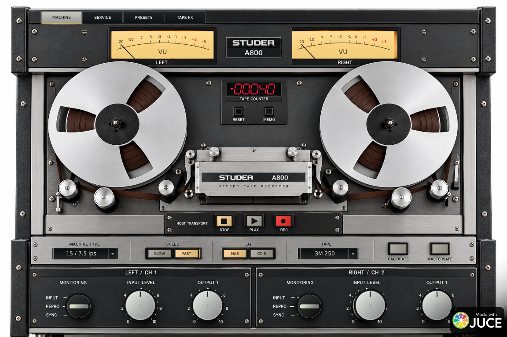

# Download — A800 Tape DSP 0.3.0 — Windows x64

[Baixar VST3 compilado](A800-Tape-0.3.0-Windows-x64.zip?raw=true) · [SHA-256](A800-Tape-0.3.0-Windows-x64.zip.sha256)

Extraia o ZIP e copie a pasta inteira `A800 Technical Prototype.vst3` para `C:\Program Files\Common Files\VST3`. Feche a DAW antes de substituir a versão anterior e faça nova varredura depois. O pacote inclui manual, presets e relatórios de validação.

Modelo aproximado de fita, sem calibração por medições da A800. VARISPEED modifica o timbre, sem transposição contínua. PLAY/STOP dependem dos hosts Windows suportados. [Detalhes](../docs/TAPE-DSP.md) e [validação](../docs/VALIDATION-0.3.0.md).

Versões anteriores permanecem nesta pasta para histórico.
