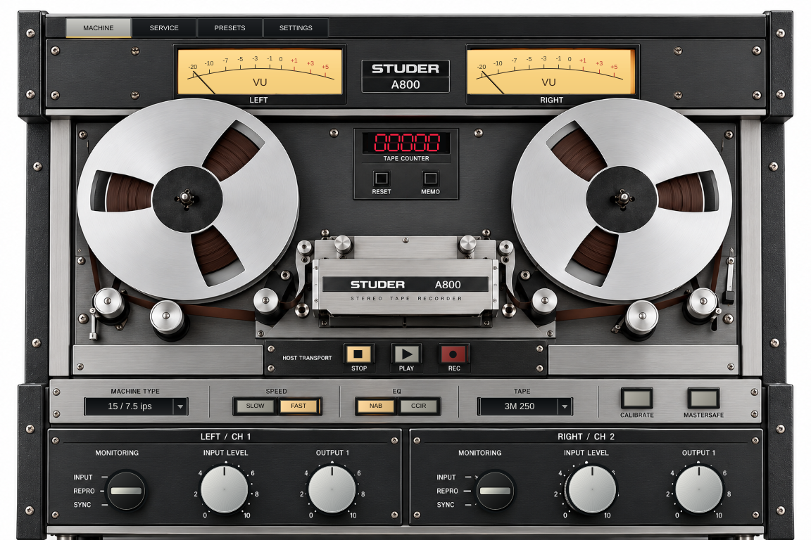

# Download — A800 / interface visual 0.2.0

**[Baixar VST3 Windows x64 — versão visual 0.2.0](./A800-Visual-0.2.0-Windows-x64.zip?raw=true)**

[Baixar código-fonte](./A800-Technical-Prototype-Source.zip?raw=true) · [SHA256](./SHA256SUMS.txt)

## O que mudou

Painel baseado na própria imagem estéreo de referência: carretéis, fita, cabeças, metal, parafusos e serigrafia. Knobs e seletores interativos, VUs RMS, contador do host, lâmpadas de transporte e animação dos carretéis. Abas MACHINE, SERVICE, PRESETS e SETTINGS; busca e carregamento dos 90 alinhamentos. Janela redimensionável.

A imagem está embutida no plugin: não é necessário copiar arquivos de arte separadamente. Foram preservados os IDs do plugin e dos parâmetros.

## Atualizar no Windows / Studio One Pro 8

1. Feche a DAW antes de substituir o plugin.
2. Baixe e extraia o ZIP **0.2.0** acima.
3. Substitua a pasta inteira `A800 Technical Prototype.vst3` em `C:\Program Files\Common Files\VST3\` pela nova pasta do ZIP. Evite cópias antigas em outras pastas de plugins.
4. Abra o Studio One e refaça a busca de VST3. Se houver uma entrada bloqueada de testes anteriores, redefina a lista de bloqueio e faça nova busca nas configurações de plugins.
5. Insira numa faixa estéreo. O arquivo VST3 não é um aplicativo para abrir com duplo clique.

## Validação e limites

Os testes diretos do novo editor passaram: abrir/fechar três vezes, knobs/seletores, abas, busca de presets e redimensionamento. O pluginval strictness 5 sem GUI passou no binário Windows 0.2.0, até 192 kHz. A validação completa ainda teve timeout de interface sob Wine; não houve teste direto em Studio One neste ambiente.

Esta atualização é visual e de medição. O DSP continua um protótipo de ganhos e roteamento: saturação de fita, EQ e bias ainda não estão implementados. Os 90 presets são alinhamentos, não 90 timbres distintos. SETTINGS e o relatório incluído explicam o estado real da implementação.
